# Task 1 - Bug Report Draft

29 nhóm dự thảo từ 31 mục Failed; chưa xác nhận số nguyên nhân gốc độc lập. Nguồn đóng góp được khai báo tập trung ở mục Disclosure của Task1_AI_Assistance_Draft. Đã tạo 29 GitHub Issues tại https://github.com/quocthaiLN/software-testing-hw03/issues; đối chiếu từng URL ở mỗi mục.

## AI-DRAFT-001 - Tiêu đề hiển thị Đăng Ký khi mở trang đăng nhập

**Module / Requirement:** A / H2/H4

**Related checklist IDs:** GUI-A-001

**Severity:** Minor (đề xuất)

**Description:** Heading hiển thị “Đăng Ký” thay vì nội dung đăng nhập. Không suy đoán nguyên nhân gốc từ assertion đơn lẻ.

**Environment:** Linux / Edge headless 155.0.4283.45 / viewport {'width': 1280, 'height': 800}

**Preconditions:** SUT local đang chạy; fixture/tài khoản/sản phẩm/coupon riêng theo script; đối chiếu giá trị chính xác trong raw JSON và file test được nêu dưới.

**Steps to reproduce:** Mở /login, đọc tiêu đề hiển thị. Tái hiện bằng scenario GUI-A-001 trong tools/gui/tests/login.spec.mjs; dùng GUI_RUN_ID mới. Fixture phải theo script, không dùng tài khoản dùng chung để thử khóa.

**Expected result:** Tiêu đề mô tả đăng nhập, không gọi là đăng ký.

**Actual result:** Heading hiển thị “Đăng Ký” thay vì nội dung đăng nhập.

**Raw evidence:** evidence/gui/login_execution.json; Run ID T1A_20261110_01_GUI-A-001; observed time 2026-11-10T12:40:54.651Z

**Screenshot files:** evidence/gui/T1A_20261110_01/artifacts/login-GUI-A-001-title-describes-login/test-failed-1.png

**GitHub Issue:** [#1](https://github.com/quocthaiLN/software-testing-hw03/issues/1)

Ảnh gốc:

## AI-DRAFT-002 - Không có h1 khi mở trang đăng nhập

**Module / Requirement:** A / FR-21

**Related checklist IDs:** GUI-A-002

**Severity:** Minor (đề xuất)

**Description:** Locator heading level 1 trả về 0 phần tử; kỳ vọng 1. Không suy đoán nguyên nhân gốc từ assertion đơn lẻ.

**Environment:** Linux / Edge headless 155.0.4283.45 / viewport {'width': 1280, 'height': 800}

**Preconditions:** SUT local đang chạy; fixture/tài khoản/sản phẩm/coupon riêng theo script; đối chiếu giá trị chính xác trong raw JSON và file test được nêu dưới.

**Steps to reproduce:** Mở /login; kiểm tra heading trong DOM. Tái hiện bằng scenario GUI-A-002 trong tools/gui/tests/login.spec.mjs; dùng GUI_RUN_ID mới. Fixture phải theo script, không dùng tài khoản dùng chung để thử khóa.

**Expected result:** Đúng một h1 mô tả nội dung đăng nhập.

**Actual result:** Locator heading level 1 trả về 0 phần tử; kỳ vọng 1.

**Raw evidence:** evidence/gui/login_execution.json; Run ID T1A_20261110_01_GUI-A-002; observed time 2026-11-10T12:40:59.218Z

**Screenshot files:** evidence/gui/T1A_20261110_01/artifacts/login-GUI-A-002-exactly-one-h1/test-failed-1.png

**GitHub Issue:** [#2](https://github.com/quocthaiLN/software-testing-hw03/issues/2)

Ảnh gốc:
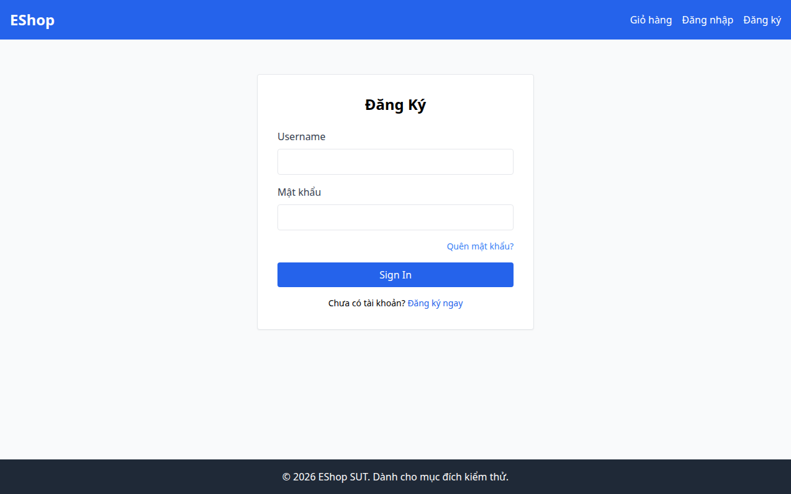

## AI-DRAFT-003 - Nút gửi hiển thị Sign In khi mở form tiếng Việt

**Module / Requirement:** A / FR-21

**Related checklist IDs:** GUI-A-003

**Severity:** Minor (đề xuất)

**Description:** Nút gửi mang nhãn “Sign In”; nhãn “Username” cũng xuất hiện trong ảnh/text quan sát. Không suy đoán nguyên nhân gốc từ assertion đơn lẻ.

**Environment:** Linux / Edge headless 155.0.4283.45 / viewport {'width': 1280, 'height': 800}

**Preconditions:** SUT local đang chạy; fixture/tài khoản/sản phẩm/coupon riêng theo script; đối chiếu giá trị chính xác trong raw JSON và file test được nêu dưới.

**Steps to reproduce:** Đọc nhãn email, mật khẩu, nút và liên kết. Tái hiện bằng scenario GUI-A-003 trong tools/gui/tests/login.spec.mjs; dùng GUI_RUN_ID mới. Fixture phải theo script, không dùng tài khoản dùng chung để thử khóa.

**Expected result:** Nhãn giao diện dùng tiếng Việt, ngoại trừ thuật ngữ kỹ thuật thông dụng.

**Actual result:** Nút gửi mang nhãn “Sign In”; nhãn “Username” cũng xuất hiện trong ảnh/text quan sát.

**Raw evidence:** evidence/gui/login_execution.json; Run ID T1A_20261110_02_GUI-A-003; observed time 2026-11-10T12:42:52.051Z

**Screenshot files:** evidence/gui/T1A_20261110_02/artifacts/login-GUI-A-003-Vietnamese-form-labels/test-failed-1.png

**GitHub Issue:** [#3](https://github.com/quocthaiLN/software-testing-hw03/issues/3)

Ảnh gốc:

## AI-DRAFT-004 - Ô email dùng type text khi mở form đăng nhập

**Module / Requirement:** A / FR-02; FR-22

**Related checklist IDs:** GUI-A-005

**Severity:** Minor (đề xuất)

**Description:** DOM trả type="text" thay vì "email". Assertion type thất bại trước các kiểm tra tiếp theo. Không suy đoán nguyên nhân gốc từ assertion đơn lẻ.

**Environment:** Linux / Edge headless 155.0.4283.45 / viewport {'width': 1280, 'height': 800}

**Preconditions:** SUT local đang chạy; fixture/tài khoản/sản phẩm/coupon riêng theo script; đối chiếu giá trị chính xác trong raw JSON và file test được nêu dưới.

**Steps to reproduce:** Nhập email hợp lệ và sai định dạng; kiểm tra thuộc tính input. Tái hiện bằng scenario GUI-A-005 trong tools/gui/tests/login.spec.mjs; dùng GUI_RUN_ID mới. Fixture phải theo script, không dùng tài khoản dùng chung để thử khóa.

**Expected result:** Input type=email; giữ email hợp lệ và có validate HTML5 cho email sai định dạng.

**Actual result:** DOM trả type="text" thay vì "email". Assertion type thất bại trước các kiểm tra tiếp theo.

**Raw evidence:** evidence/gui/login_execution.json; Run ID T1A_20261110_01_GUI-A-005; observed time 2026-11-10T12:41:07.217Z

**Screenshot files:** evidence/gui/T1A_20261110_01/artifacts/login-GUI-A-005-email-input-type-and-invalid-format/test-failed-1.png

**GitHub Issue:** [#4](https://github.com/quocthaiLN/software-testing-hw03/issues/4)

Ảnh gốc:

## AI-DRAFT-005 - Ô mật khẩu dùng type text khi nhập mật khẩu

**Module / Requirement:** A / FR-22

**Related checklist IDs:** GUI-A-006

**Severity:** Major (đề xuất)

**Description:** DOM trả type="text" thay vì "password"; trường chứa mật khẩu thử GuiDemo123!. Không suy đoán nguyên nhân gốc từ assertion đơn lẻ.

**Environment:** Linux / Edge headless 155.0.4283.45 / viewport {'width': 1280, 'height': 800}

**Preconditions:** SUT local đang chạy; fixture/tài khoản/sản phẩm/coupon riêng theo script; đối chiếu giá trị chính xác trong raw JSON và file test được nêu dưới.

**Steps to reproduce:** Gõ mật khẩu demo, kiểm tra hiển thị và input type. Tái hiện bằng scenario GUI-A-006 trong tools/gui/tests/login.spec.mjs; dùng GUI_RUN_ID mới. Fixture phải theo script, không dùng tài khoản dùng chung để thử khóa.

**Expected result:** type=password, ký tự không lộ rõ.

**Actual result:** DOM trả type="text" thay vì "password"; trường chứa mật khẩu thử GuiDemo123!.

**Raw evidence:** evidence/gui/login_execution.json; Run ID T1A_20261110_01_GUI-A-006; observed time 2026-11-10T12:41:10.854Z

**Screenshot files:** evidence/gui/T1A_20261110_01/artifacts/login-GUI-A-006-password-masked/test-failed-1.png

**GitHub Issue:** [#5](https://github.com/quocthaiLN/software-testing-hw03/issues/5)

Ảnh gốc:
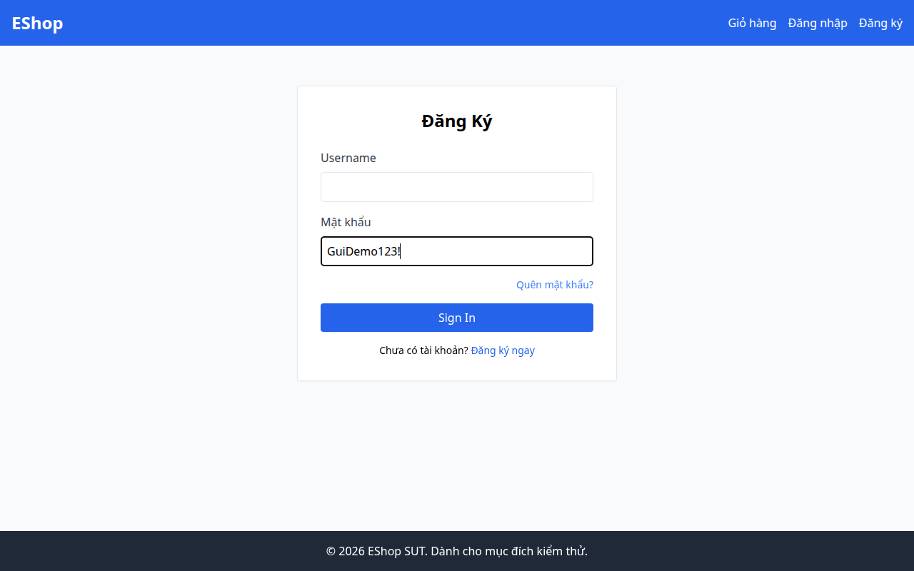

## AI-DRAFT-006 - Nhãn bắt buộc thiếu dấu sao trên form đăng nhập

**Module / Requirement:** A / FR-22

**Related checklist IDs:** GUI-A-007

**Severity:** Minor (đề xuất)

**Description:** Nhãn “Username” không chứa dấu *. Không suy rằng mọi nhãn sau assertion đầu đều đã được kiểm. Không suy đoán nguyên nhân gốc từ assertion đơn lẻ.

**Environment:** Linux / Edge headless 155.0.4283.45 / viewport {'width': 1280, 'height': 800}

**Preconditions:** SUT local đang chạy; fixture/tài khoản/sản phẩm/coupon riêng theo script; đối chiếu giá trị chính xác trong raw JSON và file test được nêu dưới.

**Steps to reproduce:** Quan sát hai trường trước khi nhập. Tái hiện bằng scenario GUI-A-007 trong tools/gui/tests/login.spec.mjs; dùng GUI_RUN_ID mới. Fixture phải theo script, không dùng tài khoản dùng chung để thử khóa.

**Expected result:** Hai trường có nhãn và dấu * rõ ràng.

**Actual result:** Nhãn “Username” không chứa dấu *. Không suy rằng mọi nhãn sau assertion đầu đều đã được kiểm.

**Raw evidence:** evidence/gui/login_execution.json; Run ID T1A_20261110_01_GUI-A-007; observed time 2026-11-10T12:41:14.752Z

**Screenshot files:** evidence/gui/T1A_20261110_01/artifacts/login-GUI-A-007-required-field-markers/test-failed-1.png

**GitHub Issue:** [#6](https://github.com/quocthaiLN/software-testing-hw03/issues/6)

Ảnh gốc:

## AI-DRAFT-007 - Focus đầu tiên không theo thứ tự đã định khi nhấn Tab

**Module / Requirement:** A / FR-21

**Related checklist IDs:** GUI-A-010

**Severity:** Minor (đề xuất)

**Description:** Sau Tab, link EShop không được focus như thứ tự trên-xuống đang kiểm; DOM nút gửi có tabindex="1" trong hồ sơ. Không suy nguyên nhân gốc. Không suy đoán nguyên nhân gốc từ assertion đơn lẻ.

**Environment:** Linux / Edge headless 155.0.4283.45 / viewport {'width': 1280, 'height': 800}

**Preconditions:** SUT local đang chạy; fixture/tài khoản/sản phẩm/coupon riêng theo script; đối chiếu giá trị chính xác trong raw JSON và file test được nêu dưới.

**Steps to reproduce:** Reload, nhấn Tab qua các điều khiển, ghi thứ tự. Tái hiện bằng scenario GUI-A-010 trong tools/gui/tests/login.spec.mjs; dùng GUI_RUN_ID mới. Fixture phải theo script, không dùng tài khoản dùng chung để thử khóa.

**Expected result:** Focus đi từ trên xuống dưới, trái sang phải, không nhảy submit trước các trường.

**Actual result:** Sau Tab, link EShop không được focus như thứ tự trên-xuống đang kiểm; DOM nút gửi có tabindex="1" trong hồ sơ. Không suy nguyên nhân gốc.

**Raw evidence:** evidence/gui/login_execution.json; Run ID T1A_20261110_01_GUI-A-010; observed time 2026-11-10T12:41:19.499Z

**Screenshot files:** evidence/gui/T1A_20261110_01/artifacts/login-GUI-A-010-natural-top-down-tab-order/test-failed-1.png

**GitHub Issue:** [#7](https://github.com/quocthaiLN/software-testing-hw03/issues/7)

Ảnh gốc:
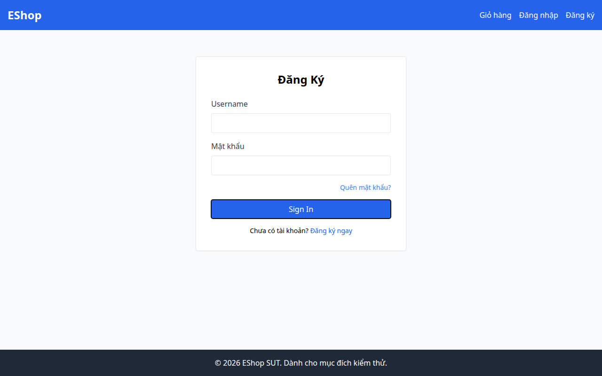

## AI-DRAFT-008 - Thông báo lỗi nằm dưới nút gửi khi đăng nhập sai

**Module / Requirement:** A / FR-22

**Related checklist IDs:** GUI-A-014

**Severity:** Minor (đề xuất)

**Description:** Phép đo đáy error=565, vị trí đầu nút submit=425; điều kiện error.bottom ≤ submit.top không đạt. Không suy đoán nguyên nhân gốc từ assertion đơn lẻ.

**Environment:** Linux / Edge headless 155.0.4283.45 / viewport {'width': 1280, 'height': 800}

**Preconditions:** SUT local đang chạy; fixture/tài khoản/sản phẩm/coupon riêng theo script; đối chiếu giá trị chính xác trong raw JSON và file test được nêu dưới.

**Steps to reproduce:** Gửi thông tin sai, quan sát vị trí thông báo. Tái hiện bằng scenario GUI-A-014 trong tools/gui/tests/login.spec.mjs; dùng GUI_RUN_ID mới. Fixture phải theo script, không dùng tài khoản dùng chung để thử khóa.

**Expected result:** Thông báo lỗi xuất hiện phía trên nút submit.

**Actual result:** Phép đo đáy error=565, vị trí đầu nút submit=425; điều kiện error.bottom ≤ submit.top không đạt.

**Raw evidence:** evidence/gui/login_execution.json; Run ID T1A_20261110_01_GUI-A-014; observed time 2026-11-10T12:41:25.163Z

**Screenshot files:** evidence/gui/T1A_20261110_01/artifacts/login-GUI-A-014-error-above-submit/test-failed-1.png

**GitHub Issue:** [#8](https://github.com/quocthaiLN/software-testing-hw03/issues/8)

Ảnh gốc:

## AI-DRAFT-009 - Đăng nhập đúng bị chặn sau hai lần sai thay vì ba

**Module / Requirement:** A / FR-02

**Related checklist IDs:** GUI-A-015

**Severity:** Major (đề xuất)

**Description:** Trên các tài khoản riêng, đăng nhập đúng sau 1/2/3 lần sai nhận HTTP 200/403/403. Sau hai lần sai vẫn ở /login. Không suy đoán nguyên nhân gốc từ assertion đơn lẻ.

**Environment:** Linux / Edge headless 155.0.4283.45 / viewport {'width': 1280, 'height': 800}

**Preconditions:** SUT local đang chạy; fixture/tài khoản/sản phẩm/coupon riêng theo script; đối chiếu giá trị chính xác trong raw JSON và file test được nêu dưới.

**Steps to reproduce:** Tài khoản mới: sai liên tiếp 1,2,3 lần; thử đúng khi vẫn trong 30 giây khóa, ghi thời điểm. Tái hiện bằng scenario GUI-A-015 trong tools/gui/tests/login.spec.mjs; dùng GUI_RUN_ID mới. Fixture phải theo script, không dùng tài khoản dùng chung để thử khóa.

**Expected result:** Lần 1/2 chưa khóa; từ lần 3 khóa; đúng mật khẩu trong thời gian khóa vẫn bị từ chối và GUI báo lỗi phù hợp.

**Actual result:** Trên các tài khoản riêng, đăng nhập đúng sau 1/2/3 lần sai nhận HTTP 200/403/403. Sau hai lần sai vẫn ở /login.

**Raw evidence:** evidence/gui/login_execution.json; Run ID T1A_20261110_01_GUI-A-015; observed time 2026-11-10T12:41:25.901Z

**Screenshot files:** evidence/gui/T1A_20261110_01/artifacts/login-GUI-A-015-lock-threshold-at-three-consecutive-failures/test-failed-1.png

**GitHub Issue:** [#9](https://github.com/quocthaiLN/software-testing-hw03/issues/9)

Ảnh gốc:

## AI-DRAFT-010 - Đăng nhập đúng vẫn bị chặn sau thời gian khóa hơn 30 giây

**Module / Requirement:** A / FR-02; H1/H9

**Related checklist IDs:** GUI-A-016

**Severity:** Major (đề xuất)

**Description:** Sau thời gian đo 31.179 ms vẫn HTTP 403 và còn ở /login; không khẳng định thời gian khóa thực tế tối đa. Không suy đoán nguyên nhân gốc từ assertion đơn lẻ.

**Environment:** Linux / Edge headless 155.0.4283.45 / viewport {'width': 1280, 'height': 800}

**Preconditions:** SUT local đang chạy; fixture/tài khoản/sản phẩm/coupon riêng theo script; đối chiếu giá trị chính xác trong raw JSON và file test được nêu dưới.

**Steps to reproduce:** Dùng cùng trạng thái khóa; thử đúng trước/sau mốc hết 30 giây, dùng timestamp request/response. Tái hiện bằng scenario GUI-A-016 trong tools/gui/tests/login.spec.mjs; dùng GUI_RUN_ID mới. Fixture phải theo script, không dùng tài khoản dùng chung để thử khóa.

**Expected result:** Sau hết thời gian khóa có thể đăng nhập đúng; không giữ lỗi cũ như trạng thái hiện tại sau thành công. Không suy ra độ chính xác thời gian từ click tay.

**Actual result:** Sau thời gian đo 31.179 ms vẫn HTTP 403 và còn ở /login; không khẳng định thời gian khóa thực tế tối đa.

**Raw evidence:** evidence/gui/login_execution.json; Run ID T1A_20261110_01_GUI-A-016; observed time 2026-11-10T12:41:30.610Z

**Screenshot files:** evidence/gui/T1A_20261110_01/artifacts/login-GUI-A-016-login-recovers-after-30-second-lock/test-failed-1.png

**GitHub Issue:** [#10](https://github.com/quocthaiLN/software-testing-hw03/issues/10)

Ảnh gốc:
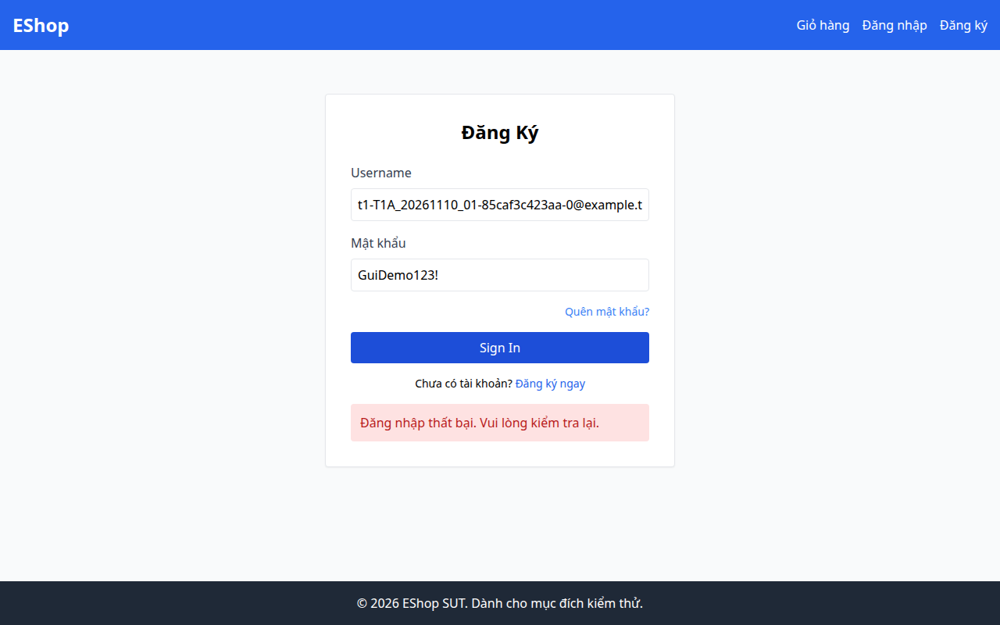

## AI-DRAFT-011 - Không tìm thấy breadcrumb khi mở Checkout

**Module / Requirement:** B / FR-23; widget Link

**Related checklist IDs:** GUI-B-004

**Severity:** Minor (đề xuất)

**Description:** Locator navigation có accessible name breadcrumb/đường dẫn không xuất hiện. Cần giữ giới hạn locator ngữ nghĩa khi diễn giải. Không suy đoán nguyên nhân gốc từ assertion đơn lẻ.

**Environment:** Linux / Edge headless 155.0.4283.45 / viewport {'width': 1280, 'height': 800}

**Preconditions:** SUT local đang chạy; fixture/tài khoản/sản phẩm/coupon riêng theo script; đối chiếu giá trị chính xác trong raw JSON và file test được nêu dưới.

**Steps to reproduce:** Mở checkout, quan sát breadcrumb; kích hoạt đích quay lại bằng click và bàn phím. Tái hiện bằng scenario GUI-B-004 trong tools/gui/tests/apply-coupon.spec.mjs; dùng GUI_RUN_ID mới. Fixture phải theo script, không dùng tài khoản dùng chung để thử khóa.

**Expected result:** Có breadcrumb cho trang con Thanh toán; liên kết hoạt động, coupon không bị gửi chỉ vì điều hướng.

**Actual result:** Locator navigation có accessible name breadcrumb/đường dẫn không xuất hiện. Cần giữ giới hạn locator ngữ nghĩa khi diễn giải.

**Raw evidence:** evidence/gui/apply_execution.json; Run ID T1B_20261110_01_GUI-B-004; observed time 2026-11-10T13:11:43.524Z

**Screenshot files:** evidence/gui/T1B_20261110_01/artifacts/apply-coupon-GUI-B-004-che-20ddb-mb-allows-return-navigation/test-failed-1.png

**GitHub Issue:** [#11](https://github.com/quocthaiLN/software-testing-hw03/issues/11)

Ảnh gốc:
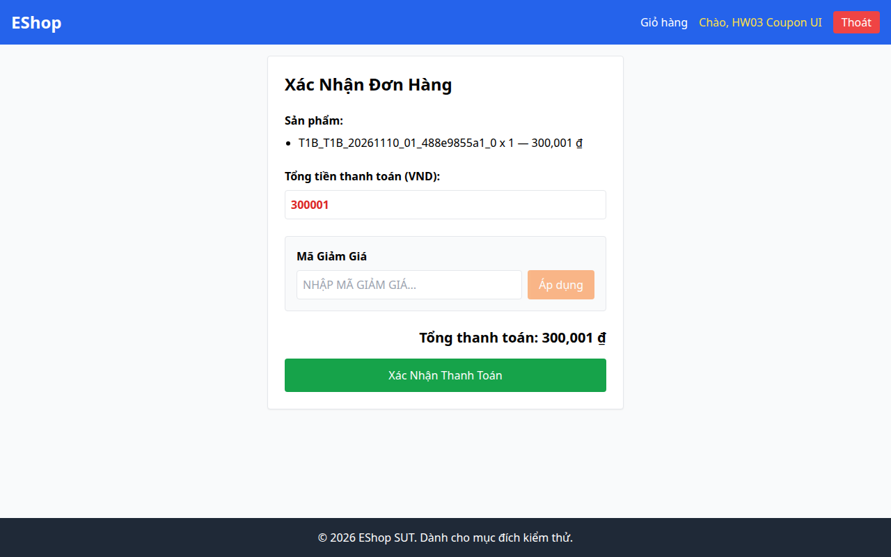

## AI-DRAFT-012 - Áp dụng mã sai tại biên tổng đơn và công thức giảm giá

**Module / Requirement:** B / FR-09 formulas; H1

**Related checklist IDs:** GUI-B-005

**Severity:** Major (đề xuất)

**Description:** SAVE10 tổng 300000 trả 400; tổng 300001 trả discount -2700009 và final 3000010. BIGBUY tổng 500000 trả 400; tổng 500001 giảm 50000, final 450001. Đây là các quan sát, không suy rounding policy. Không suy đoán nguyên nhân gốc từ assertion đơn lẻ.

**Environment:** Linux / Edge headless 155.0.4283.45 / viewport {'width': 1280, 'height': 800}

**Preconditions:** SUT local đang chạy; fixture/tài khoản/sản phẩm/coupon riêng theo script; đối chiếu giá trị chính xác trong raw JSON và file test được nêu dưới.

**Steps to reproduce:** Các phiên độc lập: SAVE10 tổng 300000 và 300001; BIGBUY tổng 500000; user có lượt, mã active/chưa hết hạn. Tái hiện bằng scenario GUI-B-005 trong tools/gui/tests/apply-coupon.spec.mjs; dùng GUI_RUN_ID mới. Fixture phải theo script, không dùng tài khoản dùng chung để thử khóa.

**Expected result:** SAVE10 tại 300000 giảm 30000 còn 270000; tại 300001 giảm 30000.1 còn 270000.9 theo công thức (quy tắc làm tròn chưa rõ). BIGBUY giảm 50000 còn 450000. GUI hiển thị rõ mã/kết quả.

**Actual result:** SAVE10 tổng 300000 trả 400; tổng 300001 trả discount -2700009 và final 3000010. BIGBUY tổng 500000 trả 400; tổng 500001 giảm 50000, final 450001. Đây là các quan sát, không suy rounding policy.

**Raw evidence:** evidence/gui/apply_execution.json; Run ID T1B_20261110_01_GUI-B-005; observed time 2026-11-10T13:11:47.458Z

**Screenshot files:** evidence/gui/T1B_20261110_01/artifacts/apply-coupon-GUI-B-005-val-e30a5--and-fixed-boundary-results/test-failed-1.png; evidence/gui/T1B_20261110_01/artifacts/apply-coupon-GUI-B-005-val-e30a5--and-fixed-boundary-results/attachments/failed-vector-screenshot-0d015817badeeee5a9e5bedfbb0905c914d34728.png; evidence/gui/T1B_20261110_01/artifacts/apply-coupon-GUI-B-005-val-e30a5--and-fixed-boundary-results/attachments/failed-vector-screenshot-a50d0edcce7ebe355541d3a8cd16c95c1a28f672.png; evidence/gui/T1B_20261110_01/artifacts/apply-coupon-GUI-B-005-val-e30a5--and-fixed-boundary-results/attachments/failed-vector-screenshot-5d7984ac573e42fcf396dc3b3949ca17bfddad2a.png

**GitHub Issue:** [#12](https://github.com/quocthaiLN/software-testing-hw03/issues/12)

Ảnh gốc:
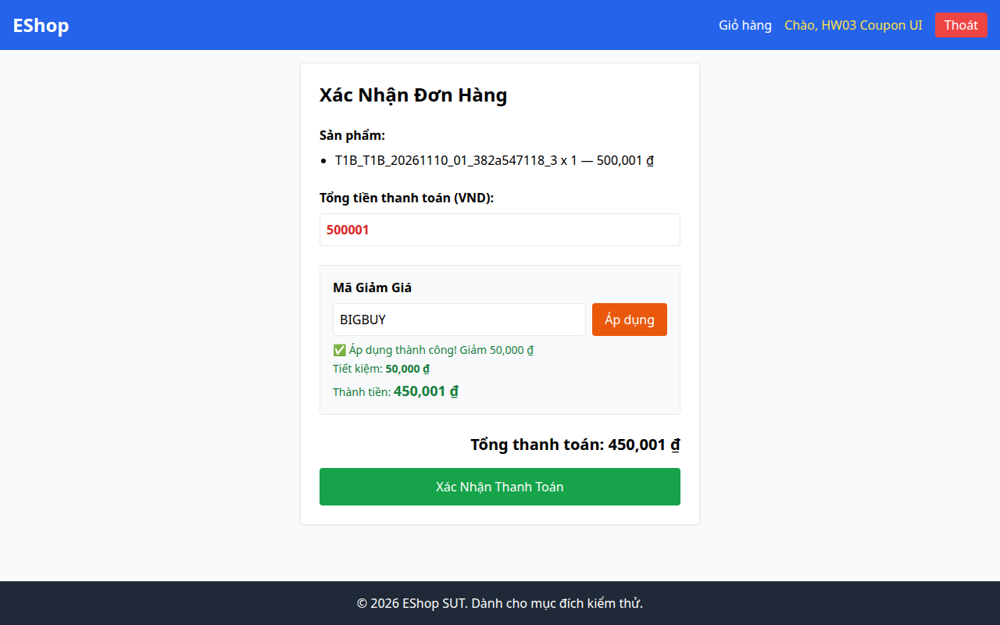
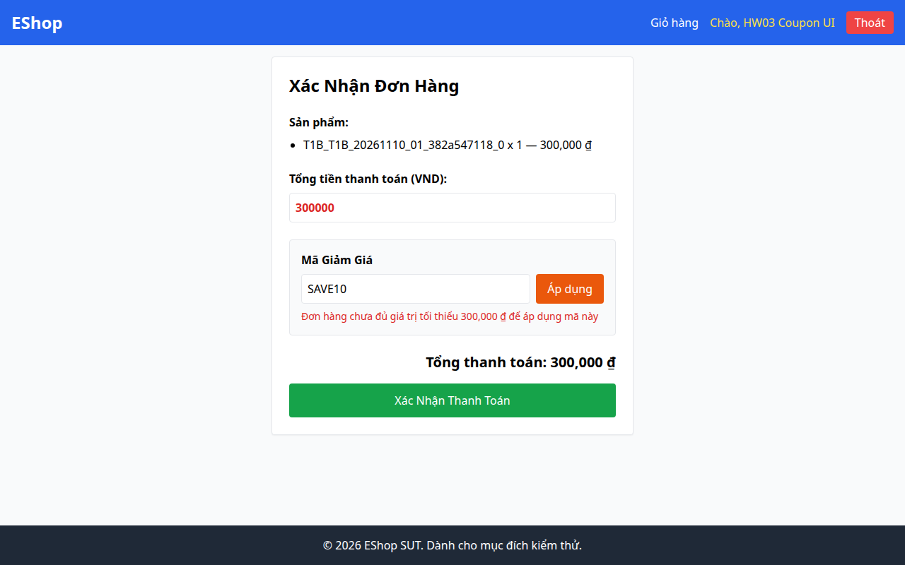

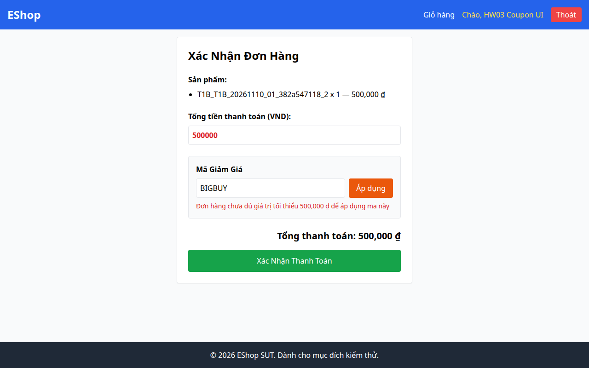

## AI-DRAFT-013 - Mã được áp dụng khi request thiếu hoặc hết hạn xác thực

**Module / Requirement:** B / FR-09 C1–C5; H9

**Related checklist IDs:** GUI-B-006

**Severity:** Major (đề xuất)

**Description:** Các vector missing-auth và expired-jwt trả HTTP 200 dù kỳ vọng bị từ chối. JWT hết hạn là fixture public demo key, thay riêng header; không coi đây là chứng minh mọi đường khai thác. Không suy đoán nguyên nhân gốc từ assertion đơn lẻ.

**Environment:** Linux / Edge headless 155.0.4283.45 / viewport {'width': 1280, 'height': 800}

**Preconditions:** SUT local đang chạy; fixture/tài khoản/sản phẩm/coupon riêng theo script; đối chiếu giá trị chính xác trong raw JSON và file test được nêu dưới.

**Steps to reproduce:** Cô lập từng điều kiện: mã không tồn tại/inactive; EXPIRED; SAVE10 tổng 299999; token thiếu/hết hạn; lượt dùng m-1,m,m+1 với các điều kiện còn lại đúng. Tái hiện bằng scenario GUI-B-006 trong tools/gui/tests/apply-coupon.spec.mjs; dùng GUI_RUN_ID mới. Fixture phải theo script, không dùng tài khoản dùng chung để thử khóa.

**Expected result:** C1–C5 đều phải đúng mới áp dụng; từ lượt m bị từ chối; lỗi nhìn thấy và không hiển thị thành công giả. Tổng biên hợp lệ nằm ở B005. Ghi cách seed, timezone và m.

**Actual result:** Các vector missing-auth và expired-jwt trả HTTP 200 dù kỳ vọng bị từ chối. JWT hết hạn là fixture public demo key, thay riêng header; không coi đây là chứng minh mọi đường khai thác.

**Raw evidence:** evidence/gui/apply_execution.json; Run ID T1B_20261110_01_GUI-B-006; observed time 2026-11-10T13:11:56.020Z

**Screenshot files:** evidence/gui/T1B_20261110_01/artifacts/apply-coupon-GUI-B-006-C1--26cc3-bility-and-usage-boundaries/test-failed-1.png; evidence/gui/T1B_20261110_01/artifacts/apply-coupon-GUI-B-006-C1--26cc3-bility-and-usage-boundaries/attachments/failed-vector-screenshot-5351da4399293cf06c598167d8e8dcfc51dc5fa4.png; evidence/gui/T1B_20261110_01/artifacts/apply-coupon-GUI-B-006-C1--26cc3-bility-and-usage-boundaries/attachments/failed-vector-screenshot-6c07a590cc1aafd7749208a986aa3d6d76759513.png

**GitHub Issue:** [#13](https://github.com/quocthaiLN/software-testing-hw03/issues/13)

Ảnh gốc:
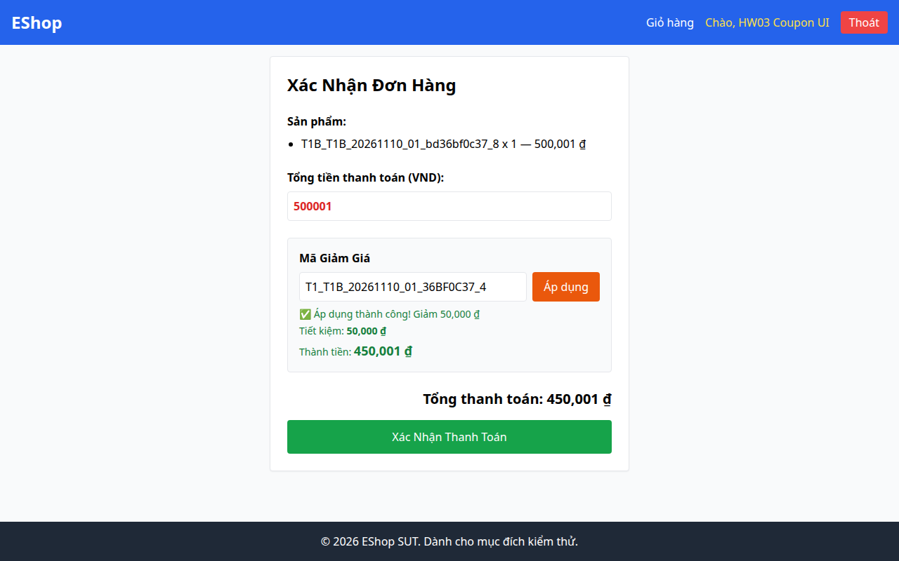
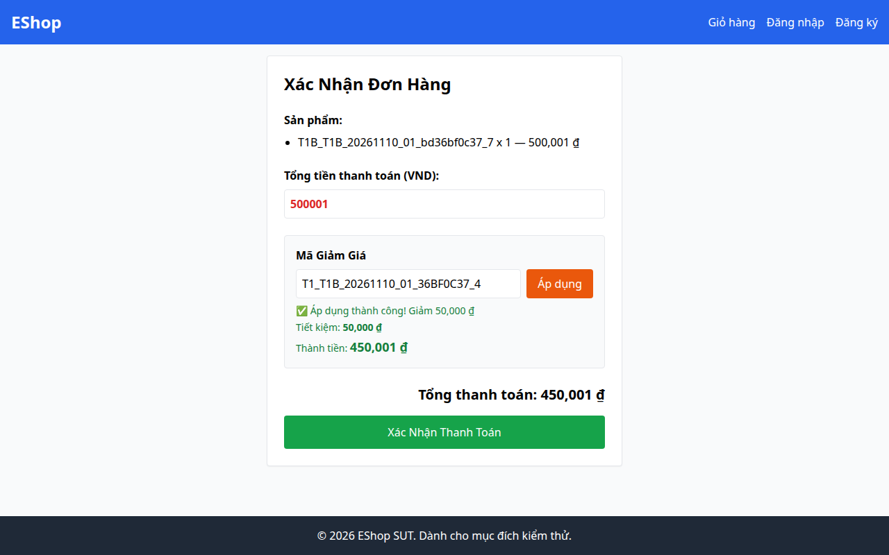

## AI-DRAFT-014 - h1 không mô tả Coupons khi mở tab Mã Giảm Giá

**Module / Requirement:** C / FR-21

**Related checklist IDs:** GUI-C-002

**Severity:** Minor (đề xuất)

**Description:** h1 duy nhất mang nội dung “EShop Admin”, không khớp ngữ cảnh Mã Giảm Giá theo tiêu chí. Không suy đoán nguyên nhân gốc từ assertion đơn lẻ.

**Environment:** Linux / Edge headless 155.0.4283.45 / viewport {'width': 1280, 'height': 800}

**Preconditions:** SUT local đang chạy; fixture/tài khoản/sản phẩm/coupon riêng theo script; đối chiếu giá trị chính xác trong raw JSON và file test được nêu dưới.

**Steps to reproduce:** Kiểm tra heading DOM ở tab Coupons. Tái hiện bằng scenario GUI-C-002 trong tools/gui/tests/coupons.spec.mjs; dùng GUI_RUN_ID mới. Fixture phải theo script, không dùng tài khoản dùng chung để thử khóa.

**Expected result:** Trang có đúng một h1 mô tả nội dung hiện tại.

**Actual result:** h1 duy nhất mang nội dung “EShop Admin”, không khớp ngữ cảnh Mã Giảm Giá theo tiêu chí.

**Raw evidence:** evidence/gui/admin_execution.json; Run ID T1C_20261110_02_GUI-C-002; observed time 2026-11-10T12:55:21.428Z

**Screenshot files:** evidence/gui/T1C_20261110_02/artifacts/coupons-GUI-C-002-one-descriptive-h1/test-failed-1.png

**GitHub Issue:** [#14](https://github.com/quocthaiLN/software-testing-hw03/issues/14)

Ảnh gốc:

## AI-DRAFT-015 - Màu nút Tạo không đạt quy tắc xanh dương

**Module / Requirement:** C / FR-21

**Related checklist IDs:** GUI-C-003

**Severity:** Minor (đề xuất)

**Description:** Điều kiện kênh blue lớn hơn red và green trả false. Assertion dừng trước phép kiểm màu nút Xóa; không kết luận màu Xóa từ lần chạy này. Không suy đoán nguyên nhân gốc từ assertion đơn lẻ.

**Environment:** Linux / Edge headless 155.0.4283.45 / viewport {'width': 1280, 'height': 800}

**Preconditions:** SUT local đang chạy; fixture/tài khoản/sản phẩm/coupon riêng theo script; đối chiếu giá trị chính xác trong raw JSON và file test được nêu dưới.

**Steps to reproduce:** Quan sát nút Tạo mã và Xóa ở trạng thái enabled. Tái hiện bằng scenario GUI-C-003 trong tools/gui/tests/coupons.spec.mjs; dùng GUI_RUN_ID mới. Fixture phải theo script, không dùng tài khoản dùng chung để thử khóa.

**Expected result:** Tạo mã màu xanh dương; hành động nguy hiểm Xóa màu đỏ.

**Actual result:** Điều kiện kênh blue lớn hơn red và green trả false. Assertion dừng trước phép kiểm màu nút Xóa; không kết luận màu Xóa từ lần chạy này.

**Raw evidence:** evidence/gui/admin_execution.json; Run ID T1C_20261110_02_GUI-C-003; observed time 2026-11-10T12:55:25.220Z

**Screenshot files:** evidence/gui/T1C_20261110_02/artifacts/coupons-GUI-C-003-create-blue-and-delete-red/test-failed-1.png

**GitHub Issue:** [#15](https://github.com/quocthaiLN/software-testing-hw03/issues/15)

Ảnh gốc:
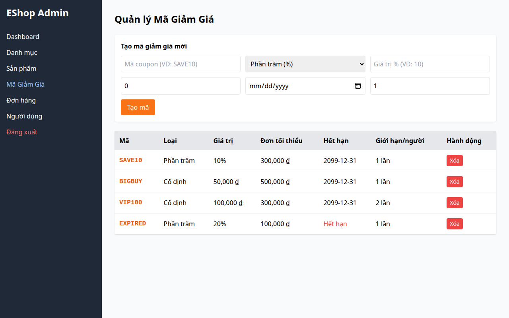

## AI-DRAFT-016 - Ô nhập không hiển thị nổi một ký tự ở viewport 390px

**Module / Requirement:** C / strategies Compatibility; H8

**Related checklist IDs:** GUI-C-006

**Severity:** Major (đề xuất)

**Description:** Phép đo available content width=0px trong khi glyph đầu khoảng 8.896–9.152px; ảnh QA xác nhận ô bị co. Kết quả geometry-only trước đây đã superseded. Không suy đoán nguyên nhân gốc từ assertion đơn lẻ.

**Environment:** Linux / Edge headless 155.0.4283.45 / viewport {'width': 390, 'height': 844}

**Preconditions:** SUT local đang chạy; fixture/tài khoản/sản phẩm/coupon riêng theo script; đối chiếu giá trị chính xác trong raw JSON và file test được nêu dưới.

**Steps to reproduce:** Kiểm tra tại viewport web 1280×800 và 390×844; cuộn nếu bảng rộng. Tái hiện bằng scenario GUI-C-006 trong tools/gui/tests/coupons.spec.mjs; dùng GUI_RUN_ID mới. Fixture phải theo script, không dùng tài khoản dùng chung để thử khóa.

**Expected result:** Không chồng lấp/cắt mất trường hoặc nút; nội dung bảng rộng tiếp cận được bằng cuộn.

**Actual result:** Phép đo available content width=0px trong khi glyph đầu khoảng 8.896–9.152px; ảnh QA xác nhận ô bị co. Kết quả geometry-only trước đây đã superseded.

**Raw evidence:** evidence/gui/admin_execution.json; Run ID T1C_20261110_04_GUI-C-006; observed time 2026-11-10T12:57:59.805Z

**Screenshot files:** evidence/gui/T1C_20261110_04/artifacts/coupons-GUI-C-006-form-does-not-overlap-on-resize/test-failed-1.png

**GitHub Issue:** [#16](https://github.com/quocthaiLN/software-testing-hw03/issues/16)

Ảnh gốc:
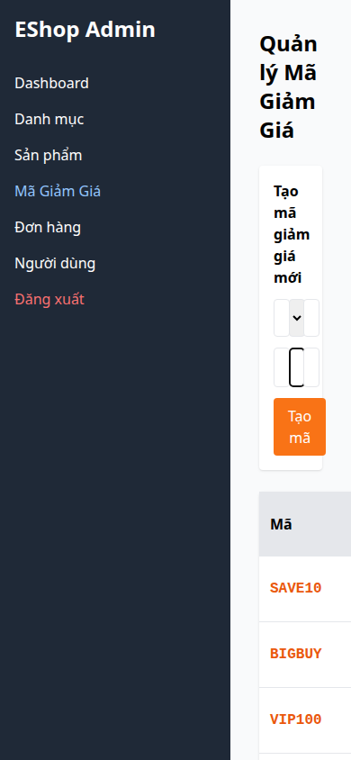

## AI-DRAFT-017 - Form tạo coupon không có label thường trực

**Module / Requirement:** C / FR-17; FR-22; H6

**Related checklist IDs:** GUI-C-007

**Severity:** Minor (đề xuất)

**Description:** Locator form label trả 0, kỳ vọng 6. Assertion dừng trước các kiểm tra tiếp theo về dấu *. Không suy đoán nguyên nhân gốc từ assertion đơn lẻ.

**Environment:** Linux / Edge headless 155.0.4283.45 / viewport {'width': 1280, 'height': 800}

**Preconditions:** SUT local đang chạy; fixture/tài khoản/sản phẩm/coupon riêng theo script; đối chiếu giá trị chính xác trong raw JSON và file test được nêu dưới.

**Steps to reproduce:** Quan sát form rỗng rồi điền đủ dữ liệu. Tái hiện bằng scenario GUI-C-007 trong tools/gui/tests/coupons.spec.mjs; dùng GUI_RUN_ID mới. Fixture phải theo script, không dùng tài khoản dùng chung để thử khóa.

**Expected result:** Cả sáu trường FR-17 có nhãn/dấu *; không chỉ dựa placeholder biến mất để nhận biết ý nghĩa.

**Actual result:** Locator form label trả 0, kỳ vọng 6. Assertion dừng trước các kiểm tra tiếp theo về dấu *.

**Raw evidence:** evidence/gui/admin_execution.json; Run ID T1C_20261110_02_GUI-C-007; observed time 2026-11-10T12:55:27.937Z

**Screenshot files:** evidence/gui/T1C_20261110_02/artifacts/coupons-GUI-C-007-persistent-labels-and-required-markers/test-failed-1.png

**GitHub Issue:** [#17](https://github.com/quocthaiLN/software-testing-hw03/issues/17)

Ảnh gốc:
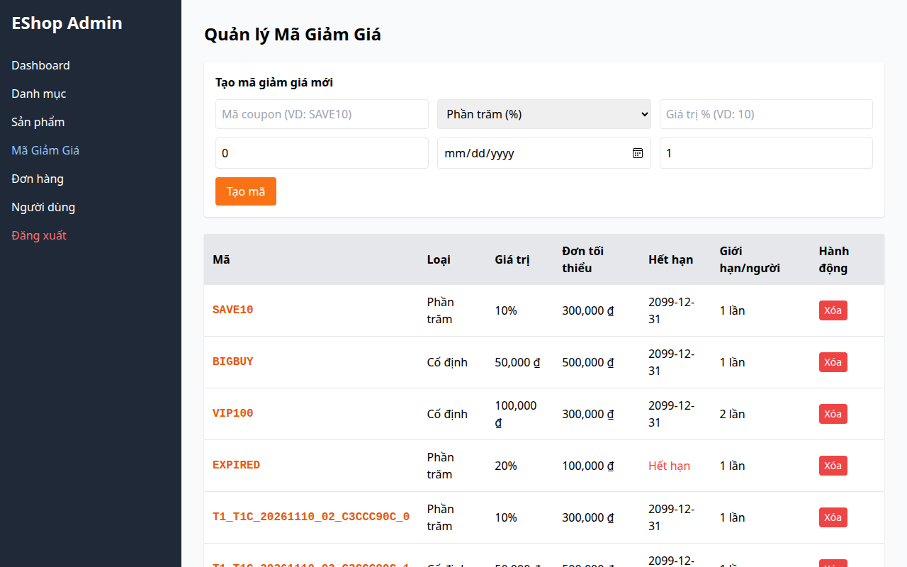

## AI-DRAFT-018 - Mã chỉ gồm khoảng trắng được lưu khi tạo coupon

**Module / Requirement:** C / FR-17 code required; widget Text Boxes Edge input

**Related checklist IDs:** GUI-C-008

**Severity:** Major (đề xuất)

**Description:** Vector code chỉ chứa khoảng trắng được lưu: saved=true trong khi shouldAccept=false. Không suy đoán nguyên nhân gốc từ assertion đơn lẻ.

**Environment:** Linux / Edge headless 155.0.4283.45 / viewport {'width': 1280, 'height': 800}

**Preconditions:** SUT local đang chạy; fixture/tài khoản/sản phẩm/coupon riêng theo script; đối chiếu giá trị chính xác trong raw JSON và file test được nêu dưới.

**Steps to reproduce:** Submit code trống và chỉ có dấu cách, giữ các trường còn lại hợp lệ. Tái hiện bằng scenario GUI-C-008 trong tools/gui/tests/coupons.spec.mjs; dùng GUI_RUN_ID mới. Fixture phải theo script, không dùng tài khoản dùng chung để thử khóa.

**Expected result:** Không tạo mã không có nội dung; phản hồi rõ nguyên nhân.

**Actual result:** Vector code chỉ chứa khoảng trắng được lưu: saved=true trong khi shouldAccept=false.

**Raw evidence:** evidence/gui/admin_execution.json; Run ID T1C_20261110_02_GUI-C-008; observed time 2026-11-10T12:55:31.734Z

**Screenshot files:** evidence/gui/T1C_20261110_02/artifacts/coupons-GUI-C-008-empty-and-whitespace-code-rejected/test-failed-1.png; evidence/gui/T1C_20261110_02/artifacts/coupons-GUI-C-008-empty-and-whitespace-code-rejected/attachments/failed-vector-screenshot-dd47e5f79091326a68927714065be1232f4fbc59.png

**GitHub Issue:** [#18](https://github.com/quocthaiLN/software-testing-hw03/issues/18)

Ảnh gốc:
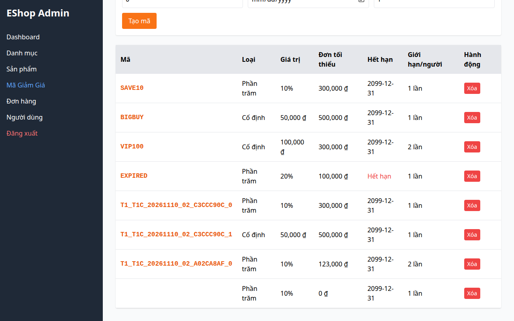

## AI-DRAFT-019 - Giá trị giảm âm được lưu khi tạo coupon

**Module / Requirement:** C / FR-17 discount_value positive

**Related checklist IDs:** GUI-C-011

**Severity:** Major (đề xuất)

**Description:** Vector discount_value=-1 được lưu dù kỳ vọng từ chối. Các vector đầy đủ nằm trong JSON gốc. Không suy đoán nguyên nhân gốc từ assertion đơn lẻ.

**Environment:** Linux / Edge headless 155.0.4283.45 / viewport {'width': 1280, 'height': 800}

**Preconditions:** SUT local đang chạy; fixture/tài khoản/sản phẩm/coupon riêng theo script; đối chiếu giá trị chính xác trong raw JSON và file test được nêu dưới.

**Steps to reproduce:** Chạy các biến thể discount_value=-1,0,1 cho mỗi loại với dữ liệu khác hợp lệ. Tái hiện bằng scenario GUI-C-011 trong tools/gui/tests/coupons.spec.mjs; dùng GUI_RUN_ID mới. Fixture phải theo script, không dùng tài khoản dùng chung để thử khóa.

**Expected result:** -1 và 0 bị từ chối; 1 hợp lệ. Không tự giới hạn percent tối đa 100.

**Actual result:** Vector discount_value=-1 được lưu dù kỳ vọng từ chối. Các vector đầy đủ nằm trong JSON gốc.

**Raw evidence:** evidence/gui/admin_execution.json; Run ID T1C_20261110_02_GUI-C-011; observed time 2026-11-10T12:55:34.304Z

**Screenshot files:** evidence/gui/T1C_20261110_02/artifacts/coupons-GUI-C-011-discount-value-boundaries/test-failed-1.png; evidence/gui/T1C_20261110_02/artifacts/coupons-GUI-C-011-discount-value-boundaries/attachments/failed-vector-screenshot-c987449da54c42a0a6eb5ad53ccaac53c2b614dd.png; evidence/gui/T1C_20261110_02/artifacts/coupons-GUI-C-011-discount-value-boundaries/attachments/failed-vector-screenshot-b4aa88cf82f4afe201180f980c4a1c826e14e0c4.png; evidence/gui/T1C_20261110_02/artifacts/coupons-GUI-C-011-discount-value-boundaries/attachments/failed-vector-screenshot-adc4ec66cf0a459ec8d862a320d3890bb7fe141a.png; evidence/gui/T1C_20261110_02/artifacts/coupons-GUI-C-011-discount-value-boundaries/attachments/failed-vector-screenshot-bcfaade74f6d5fe0dc26fdeb8eed9a3d69064dbf.png

**GitHub Issue:** [#19](https://github.com/quocthaiLN/software-testing-hw03/issues/19)

Ảnh gốc:

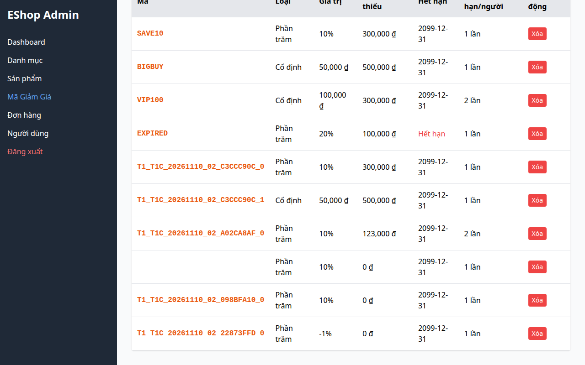
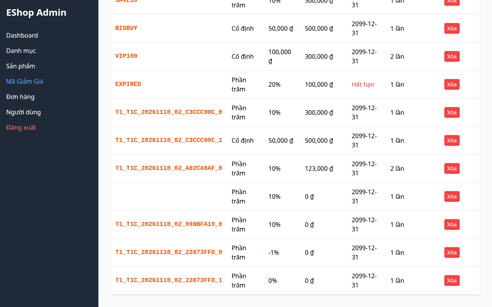
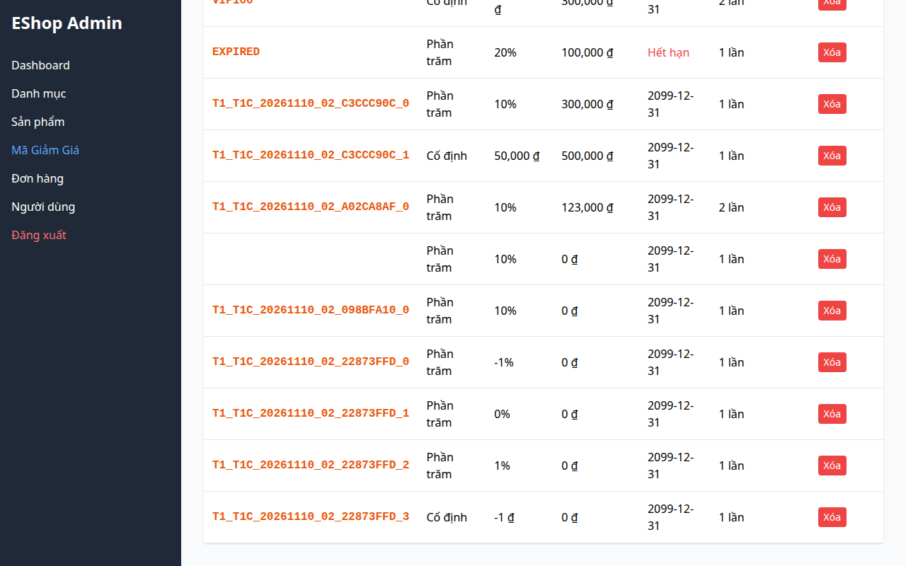
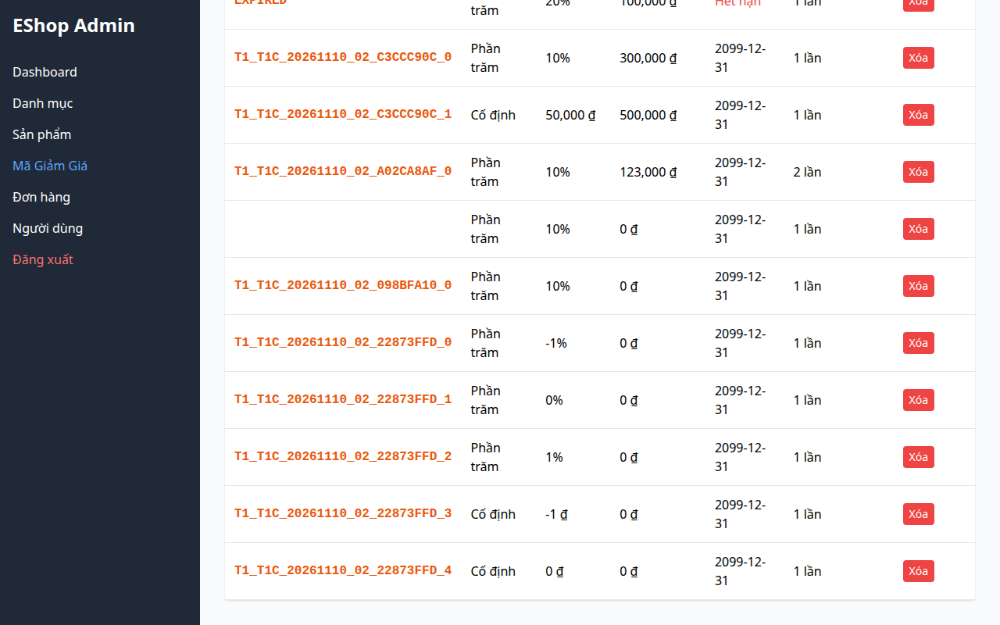

## AI-DRAFT-020 - Ngưỡng đơn âm được lưu khi tạo coupon

**Module / Requirement:** C / FR-17 min_order_amount >=0

**Related checklist IDs:** GUI-C-012

**Severity:** Major (đề xuất)

**Description:** Vector min_order_amount=-1 được lưu dù kỳ vọng từ chối. Không suy đoán nguyên nhân gốc từ assertion đơn lẻ.

**Environment:** Linux / Edge headless 155.0.4283.45 / viewport {'width': 1280, 'height': 800}

**Preconditions:** SUT local đang chạy; fixture/tài khoản/sản phẩm/coupon riêng theo script; đối chiếu giá trị chính xác trong raw JSON và file test được nêu dưới.

**Steps to reproduce:** Chạy min_order_amount=-1,0,1 riêng biệt. Tái hiện bằng scenario GUI-C-012 trong tools/gui/tests/coupons.spec.mjs; dùng GUI_RUN_ID mới. Fixture phải theo script, không dùng tài khoản dùng chung để thử khóa.

**Expected result:** -1 bị từ chối; 0 và 1 hợp lệ.

**Actual result:** Vector min_order_amount=-1 được lưu dù kỳ vọng từ chối.

**Raw evidence:** evidence/gui/admin_execution.json; Run ID T1C_20261110_02_GUI-C-012; observed time 2026-11-10T12:55:36.654Z

**Screenshot files:** evidence/gui/T1C_20261110_02/artifacts/coupons-GUI-C-012-minimum-order-boundaries/test-failed-1.png; evidence/gui/T1C_20261110_02/artifacts/coupons-GUI-C-012-minimum-order-boundaries/attachments/failed-vector-screenshot-06dab7086b1658142682f489c402ca54f59e02e9.png

**GitHub Issue:** [#20](https://github.com/quocthaiLN/software-testing-hw03/issues/20)

Ảnh gốc:
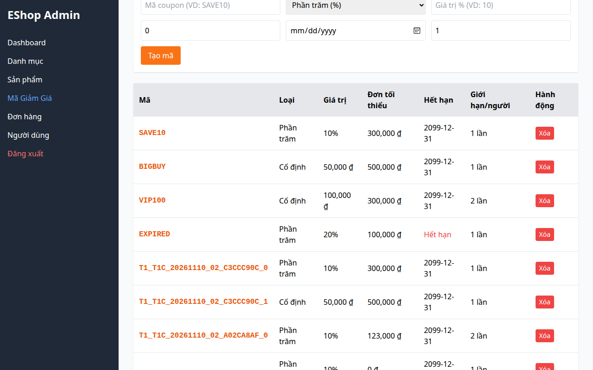
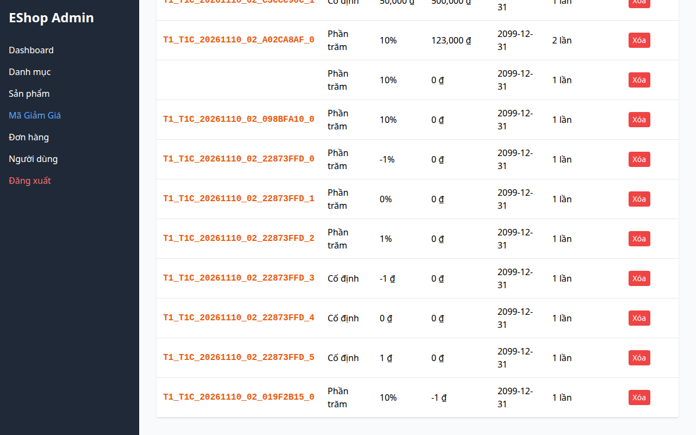

## AI-DRAFT-021 - Ngưỡng đơn bỏ trống vẫn được lưu khi tạo coupon

**Module / Requirement:** C / FR-17 required fields

**Related checklist IDs:** GUI-C-014

**Severity:** Major (đề xuất)

**Description:** Vector min_order_amount rỗng được lưu dù kỳ vọng từ chối; không suy mọi trường trống có cùng hành vi. Không suy đoán nguyên nhân gốc từ assertion đơn lẻ.

**Environment:** Linux / Edge headless 155.0.4283.45 / viewport {'width': 1280, 'height': 800}

**Preconditions:** SUT local đang chạy; fixture/tài khoản/sản phẩm/coupon riêng theo script; đối chiếu giá trị chính xác trong raw JSON và file test được nêu dưới.

**Steps to reproduce:** Lần lượt xóa discount_value, min_order_amount, expired_at, max_uses_per_user rồi submit. Tái hiện bằng scenario GUI-C-014 trong tools/gui/tests/coupons.spec.mjs; dùng GUI_RUN_ID mới. Fixture phải theo script, không dùng tài khoản dùng chung để thử khóa.

**Expected result:** Mỗi trường bị bỏ trống đều bị từ chối, không bị thay ngầm bằng 0/giá trị cũ.

**Actual result:** Vector min_order_amount rỗng được lưu dù kỳ vọng từ chối; không suy mọi trường trống có cùng hành vi.

**Raw evidence:** evidence/gui/admin_execution.json; Run ID T1C_20261110_02_GUI-C-014; observed time 2026-11-10T12:55:39.858Z

**Screenshot files:** evidence/gui/T1C_20261110_02/artifacts/coupons-GUI-C-014-all-mandatory-fields-reject-empty-values/test-failed-1.png; evidence/gui/T1C_20261110_02/artifacts/coupons-GUI-C-014-all-mandatory-fields-reject-empty-values/attachments/failed-vector-screenshot-c1090908fc8a32a4440e509864f3404a924a238d.png; evidence/gui/T1C_20261110_02/artifacts/coupons-GUI-C-014-all-mandatory-fields-reject-empty-values/attachments/failed-vector-screenshot-97cf7f491768c94cc36652710021c0b00fc67ba7.png

**GitHub Issue:** [#21](https://github.com/quocthaiLN/software-testing-hw03/issues/21)

Ảnh gốc:

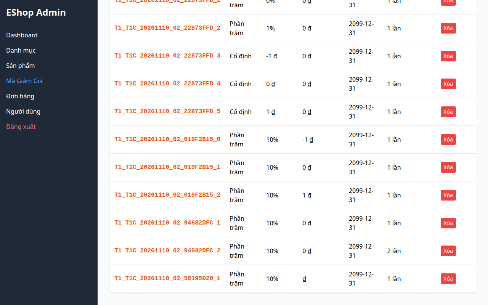
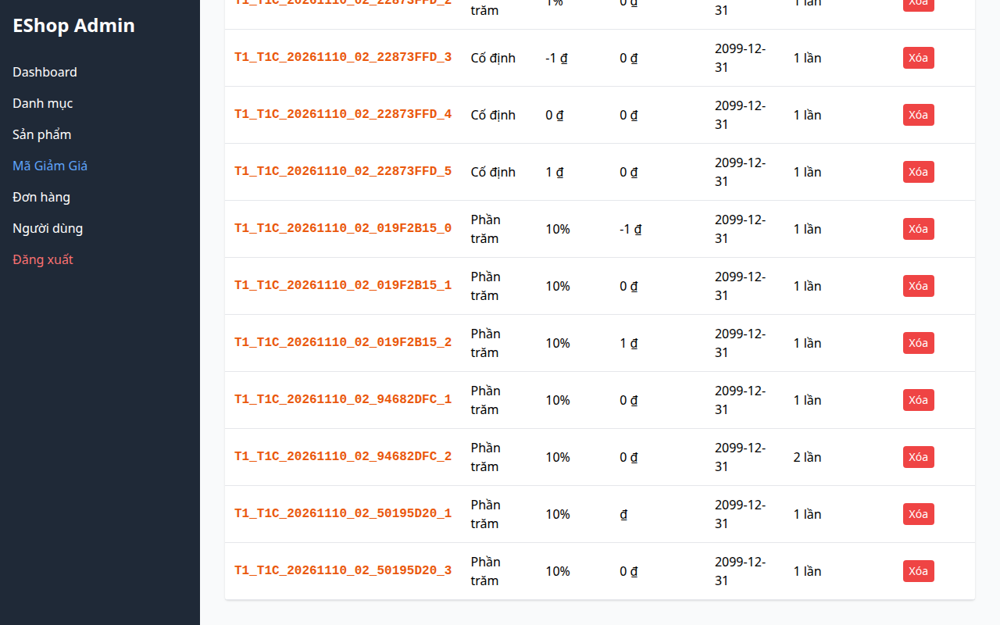

## AI-DRAFT-022 - Tab Coupons không nhận focus khi điều hướng bàn phím

**Module / Requirement:** C / widget Link/Buttons Focus; H7

**Related checklist IDs:** GUI-C-021

**Severity:** Minor (đề xuất)

**Description:** Sau tối đa 18 lần Tab, phần tử tab Coupons chưa thành document.activeElement. Đây là đường Tab được kiểm, không kết luận tất cả cơ chế bàn phím. Không suy đoán nguyên nhân gốc từ assertion đơn lẻ.

**Environment:** Linux / Edge headless 155.0.4283.45 / viewport {'width': 1280, 'height': 800}

**Preconditions:** SUT local đang chạy; fixture/tài khoản/sản phẩm/coupon riêng theo script; đối chiếu giá trị chính xác trong raw JSON và file test được nêu dưới.

**Steps to reproduce:** Dùng Tab đến mục Coupons rồi Enter/Space theo loại control. Tái hiện bằng scenario GUI-C-021 trong tools/gui/tests/coupons.spec.mjs; dùng GUI_RUN_ID mới. Fixture phải theo script, không dùng tài khoản dùng chung để thử khóa.

**Expected result:** Có focus nhận biết được và mở tab bằng bàn phím; không bắt buộc dùng chuột.

**Actual result:** Sau tối đa 18 lần Tab, phần tử tab Coupons chưa thành document.activeElement. Đây là đường Tab được kiểm, không kết luận tất cả cơ chế bàn phím.

**Raw evidence:** evidence/gui/admin_execution.json; Run ID T1C_20261110_02_GUI-C-021; observed time 2026-11-10T12:55:44.871Z

**Screenshot files:** evidence/gui/T1C_20261110_02/artifacts/coupons-GUI-C-021-tab-reachable-by-keyboard/test-failed-1.png

**GitHub Issue:** [#22](https://github.com/quocthaiLN/software-testing-hw03/issues/22)

Ảnh gốc:
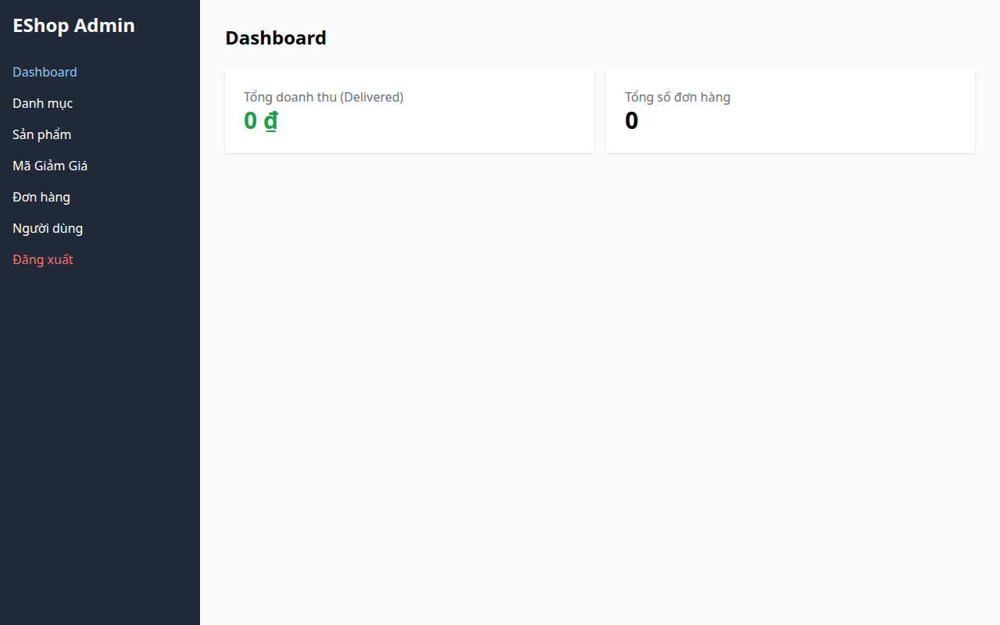

## AI-DRAFT-023 - Không thấy phản hồi rõ khi tạo mã coupon trùng

**Module / Requirement:** C / FR-22; H9

**Related checklist IDs:** GUI-C-024

**Severity:** Minor (đề xuất)

**Description:** Sau submit mã trùng, locator thông báo /mã.*tồn tại|trùng mã|không thể tạo/i không hiển thị; cần đối chiếu ảnh và text raw, không suy rằng backend đã tạo bản trùng. Không suy đoán nguyên nhân gốc từ assertion đơn lẻ.

**Environment:** Linux / Edge headless 155.0.4283.45 / viewport {'width': 1280, 'height': 800}

**Preconditions:** SUT local đang chạy; fixture/tài khoản/sản phẩm/coupon riêng theo script; đối chiếu giá trị chính xác trong raw JSON và file test được nêu dưới.

**Steps to reproduce:** Submit dữ liệu không hợp lệ/duplicate, quan sát phản hồi. Tái hiện bằng scenario GUI-C-024 trong tools/gui/tests/coupons.spec.mjs; dùng GUI_RUN_ID mới. Fixture phải theo script, không dùng tài khoản dùng chung để thử khóa.

**Expected result:** Lỗi dễ hiểu và xuất hiện trên nút submit; không báo thành công.

**Actual result:** Sau submit mã trùng, locator thông báo /mã.*tồn tại|trùng mã|không thể tạo/i không hiển thị; cần đối chiếu ảnh và text raw, không suy rằng backend đã tạo bản trùng.

**Raw evidence:** evidence/gui/admin_execution.json; Run ID T1C_20261110_02_GUI-C-024; observed time 2026-11-10T12:55:47.889Z

**Screenshot files:** evidence/gui/T1C_20261110_02/artifacts/coupons-GUI-C-024-error-understandable-and-above-submit/test-failed-1.png

**GitHub Issue:** [#23](https://github.com/quocthaiLN/software-testing-hw03/issues/23)

Ảnh gốc:
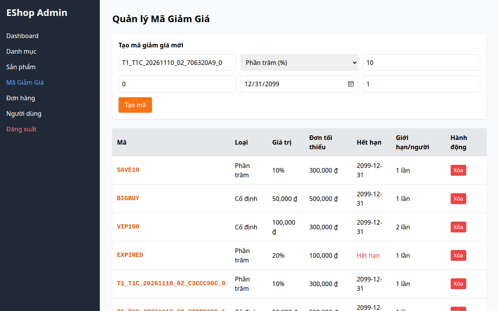

## AI-DRAFT-024 - Không có xác nhận hoặc Undo khi xóa coupon

**Module / Requirement:** C / H3/H5; widget Buttons Confirmation/Esc

**Related checklist IDs:** GUI-C-025

**Severity:** Minor (đề xuất)

**Description:** Không quan sát confirm/cancel hay Undo trong scenario xóa mã thử. Không gọi đây là yêu cầu FR-17 bắt buộc nếu nguồn chỉ là heuristic. Không suy đoán nguyên nhân gốc từ assertion đơn lẻ.

**Environment:** Linux / Edge headless 155.0.4283.45 / viewport {'width': 1280, 'height': 800}

**Preconditions:** SUT local đang chạy; fixture/tài khoản/sản phẩm/coupon riêng theo script; đối chiếu giá trị chính xác trong raw JSON và file test được nêu dưới.

**Steps to reproduce:** Với mã thử riêng, chọn Xóa; thử hủy bằng control/ESC nếu có dialog. Tái hiện bằng scenario GUI-C-025 trong tools/gui/tests/coupons.spec.mjs; dùng GUI_RUN_ID mới. Fixture phải theo script, không dùng tài khoản dùng chung để thử khóa.

**Expected result:** Có cơ chế xác nhận hoặc hoàn tác cho thao tác không thể hoàn tác; hủy không xóa dữ liệu. Đây là heuristic, không phải FR-17 bắt buộc dialog.

**Actual result:** Không quan sát confirm/cancel hay Undo trong scenario xóa mã thử. Không gọi đây là yêu cầu FR-17 bắt buộc nếu nguồn chỉ là heuristic.

**Raw evidence:** evidence/gui/admin_execution.json; Run ID T1C_20261110_02_GUI-C-025; observed time 2026-11-10T12:55:51.967Z

**Screenshot files:** evidence/gui/T1C_20261110_02/artifacts/coupons-GUI-C-025-delete-can-be-cancelled-or-undone/test-failed-1.png

**GitHub Issue:** [#24](https://github.com/quocthaiLN/software-testing-hw03/issues/24)

Ảnh gốc:
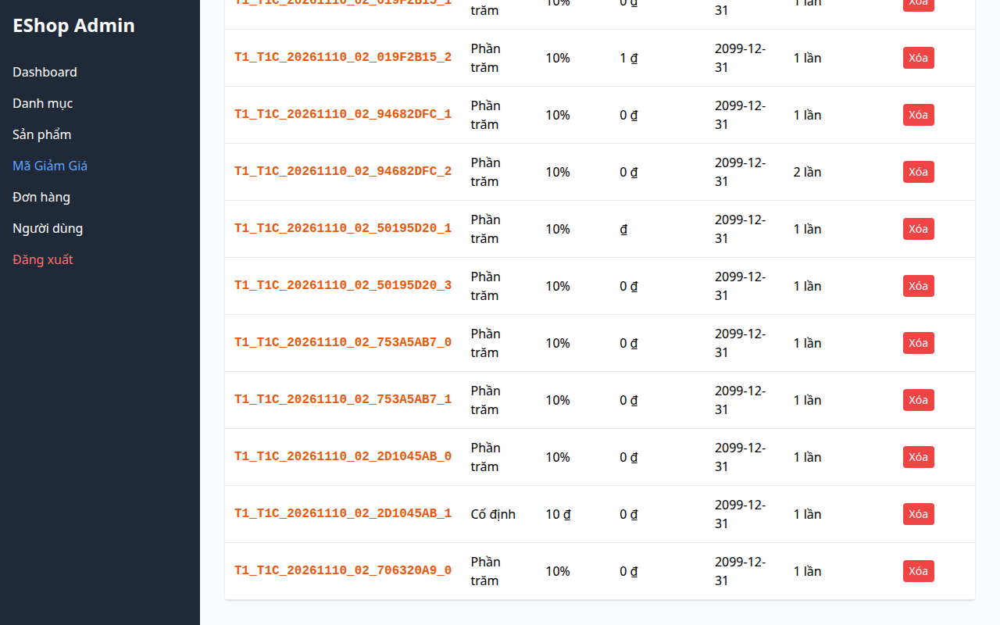

## AI-DRAFT-025 - Thiếu thông báo empty-state khi danh sách coupon rỗng

**Module / Requirement:** C / FR-24

**Related checklist IDs:** GUI-C-027

**Severity:** Minor (đề xuất)

**Description:** Với GET coupons được fulfill danh sách rỗng có kiểm soát, tbody có 0 dòng nhưng không thấy message chưa có mã/không có mã/danh sách trống. Không xóa dữ liệu dùng chung. Không suy đoán nguyên nhân gốc từ assertion đơn lẻ.

**Environment:** Linux / Edge headless 155.0.4283.45 / viewport {'width': 1280, 'height': 800}

**Preconditions:** SUT local đang chạy; fixture/tài khoản/sản phẩm/coupon riêng theo script; đối chiếu giá trị chính xác trong raw JSON và file test được nêu dưới.

**Steps to reproduce:** Trên dữ liệu thử riêng không có coupon, mở tab. Không xóa mã dùng chung để tạo tiền điều kiện. Tái hiện bằng scenario GUI-C-027 trong tools/gui/tests/coupons.spec.mjs; dùng GUI_RUN_ID mới. Fixture phải theo script, không dùng tài khoản dùng chung để thử khóa.

**Expected result:** Có message thân thiện và icon/hình minh họa cho empty state.

**Actual result:** Với GET coupons được fulfill danh sách rỗng có kiểm soát, tbody có 0 dòng nhưng không thấy message chưa có mã/không có mã/danh sách trống. Không xóa dữ liệu dùng chung.

**Raw evidence:** evidence/gui/admin_execution.json; Run ID T1C_20261110_02_GUI-C-027; observed time 2026-11-10T12:55:54.294Z

**Screenshot files:** evidence/gui/T1C_20261110_02/artifacts/coupons-GUI-C-027-empty-st-96299--isolated-empty-API-fixture/test-failed-1.png

**GitHub Issue:** [#25](https://github.com/quocthaiLN/software-testing-hw03/issues/25)

Ảnh gốc:
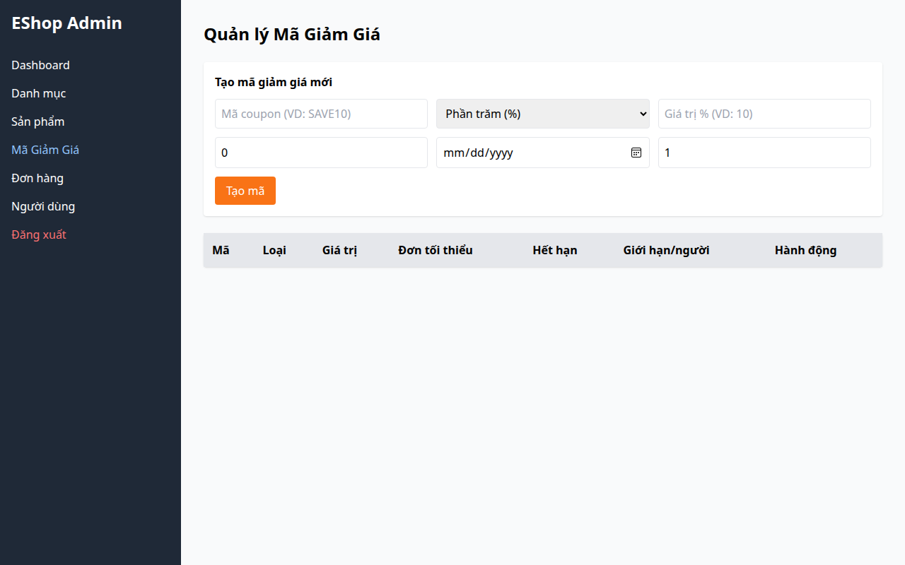

## AI-DRAFT-026 - Thiếu thông báo tải lỗi khi request coupon bị ngắt

**Module / Requirement:** C / H1/H9; strategies Integration

**Related checklist IDs:** GUI-C-028

**Severity:** Minor (đề xuất)

**Description:** GET /api/coupons bị abort có kiểm soát; không thấy lỗi tải/thử lại. Assertion đầu hỏng; các nhánh recovery/create/delete phía sau chưa được chạy. Không suy đoán nguyên nhân gốc từ assertion đơn lẻ.

**Environment:** Linux / Edge headless 155.0.4283.45 / viewport {'width': 1280, 'height': 800}

**Preconditions:** SUT local đang chạy; fixture/tài khoản/sản phẩm/coupon riêng theo script; đối chiếu giá trị chính xác trong raw JSON và file test được nêu dưới.

**Steps to reproduce:** Trên mã thử, ngắt kết nối khi tải/tạo/xóa theo từng run; khôi phục và thử lại. Tái hiện bằng scenario GUI-C-028 trong tools/gui/tests/coupons.spec.mjs; dùng GUI_RUN_ID mới. Fixture phải theo script, không dùng tài khoản dùng chung để thử khóa.

**Expected result:** Lỗi nhìn thấy, không báo thành công giả; có thể thử lại và đối chiếu dữ liệu thật sau khi phục hồi.

**Actual result:** GET /api/coupons bị abort có kiểm soát; không thấy lỗi tải/thử lại. Assertion đầu hỏng; các nhánh recovery/create/delete phía sau chưa được chạy.

**Raw evidence:** evidence/gui/admin_execution.json; Run ID T1C_20261110_02_GUI-C-028; observed time 2026-11-10T12:55:58.277Z

**Screenshot files:** evidence/gui/T1C_20261110_02/artifacts/coupons-GUI-C-028-network--8f8a8--is-visible-and-recoverable/test-failed-1.png

**GitHub Issue:** [#26](https://github.com/quocthaiLN/software-testing-hw03/issues/26)

Ảnh gốc:

## AI-DRAFT-027 - Số điện thoại đúng miền bị từ chối khi lưu Mobile Profile

**Module / Requirement:** D / FR-04

**Related checklist IDs:** GUI-D-007, GUI-D-013, GUI-D-014

**Severity:** Major (đề xuất)

**Description:** Theo người thực hiện, 0912345678 và 09123456789 đều báo lỗi; ảnh alert ghi “Số điện thoại không hợp lệ. Vui lòng nhập đúng 9-10 chữ số.” Cả vector 9/12 cũng bị từ chối đúng kỳ vọng. Ảnh đại diện, không phải frame riêng từng vector. Không suy đoán nguyên nhân gốc từ assertion đơn lẻ.

**Environment:** Android thật / Expo Go theo người thực hiện; model/build/timestamp lần chạy chưa xác minh

**Preconditions:** Tài khoản thử test@eshop.com đã đăng nhập; không có token/mật khẩu cá nhân được yêu cầu.

**Steps to reproduce:** Lần lượt nhập 091234567 / 0912345678 / 09123456789 / 091234567890 rồi lưu.

**Expected result:** 9/12 chữ số bị từ chối; 10/11 chữ số bắt đầu 0 được chấp nhận. Có phản hồi thành công và dữ liệu mới được giữ khi mở lại. Lỗi dễ hiểu, có thể sửa/thử lại; kết quả thành công thay trạng thái lỗi cũ.

**Actual result:** Theo người thực hiện, 0912345678 và 09123456789 đều báo lỗi; ảnh alert ghi “Số điện thoại không hợp lệ. Vui lòng nhập đúng 9-10 chữ số.” Cả vector 9/12 cũng bị từ chối đúng kỳ vọng. Ảnh đại diện, không phải frame riêng từng vector.

**Raw evidence:** evidence/gui/mobile_execution.json; Run ID T1D_MANUAL_01_GUI-D-007; observed time chưa có timestamp đầy đủ

**Screenshot files:** evidence/gui/T1D_MANUAL_01/image-05.png; evidence/gui/T1D_MANUAL_01/image-04.png; evidence/gui/T1D_MANUAL_01/image-06.png; evidence/gui/T1D_MANUAL_01/image-07.png; evidence/gui/T1D_MANUAL_01/image-09.png

**GitHub Issue:** [#27](https://github.com/quocthaiLN/software-testing-hw03/issues/27)

Ảnh gốc:

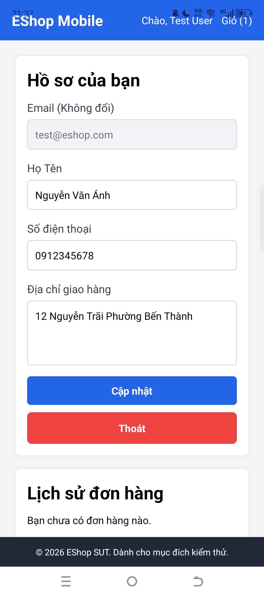
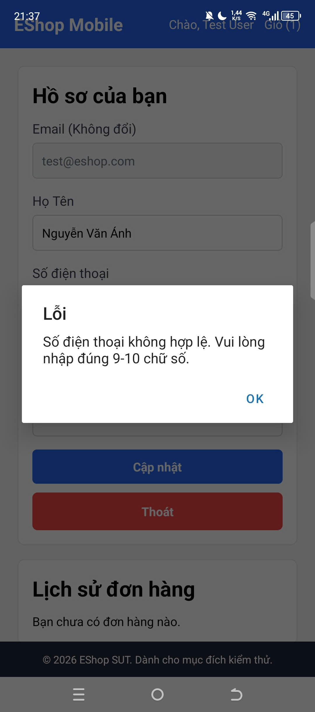

## AI-DRAFT-028 - Số không bắt đầu 0 được chấp nhận khi lưu Mobile Profile

**Module / Requirement:** D / FR-04; widget Text Boxes Input type; H7

**Related checklist IDs:** GUI-D-008

**Severity:** Major (đề xuất)

**Description:** Người dùng xác nhận 1912345678 lưu thành công, dùng ảnh 9; 09abc45678 báo lỗi ở ảnh 7. Không kết luận phần bàn phím điện thoại đã đạt. Không suy đoán nguyên nhân gốc từ assertion đơn lẻ.

**Environment:** Android thật / Expo Go theo người thực hiện; model/build/timestamp lần chạy chưa xác minh

**Preconditions:** Tài khoản thử test@eshop.com đã đăng nhập; không có token/mật khẩu cá nhân được yêu cầu.

**Steps to reproduce:** Chạm điện thoại; thử chuỗi 10 chữ số không bắt đầu 0 và chuỗi có chữ qua dán.

**Expected result:** Có bàn phím thuận nhập điện thoại; dữ liệu sai miền bị từ chối khi lưu. Không coi phone-pad là đủ validate.

**Actual result:** Người dùng xác nhận 1912345678 lưu thành công, dùng ảnh 9; 09abc45678 báo lỗi ở ảnh 7. Không kết luận phần bàn phím điện thoại đã đạt.

**Raw evidence:** evidence/gui/mobile_execution.json; Run ID T1D_MANUAL_01_GUI-D-008; observed time chưa có timestamp đầy đủ

**Screenshot files:** evidence/gui/T1D_MANUAL_01/image-07.png; evidence/gui/T1D_MANUAL_01/image-09.png

**GitHub Issue:** [#28](https://github.com/quocthaiLN/software-testing-hw03/issues/28)

Ảnh gốc:

## AI-DRAFT-029 - Nút hiển thị Thoát thay Đăng xuất trên Mobile Profile

**Module / Requirement:** D / FR-23; FR-04

**Related checklist IDs:** GUI-D-012

**Severity:** Minor (đề xuất)

**Description:** Ảnh nút ghi “Thoát”. Người dùng xác nhận sau bấm đến đăng nhập và sau đăng nhập lại mở Profile được; báo cáo này chỉ nêu sai nhãn, không khẳng định logout mất hiệu lực. Không suy đoán nguyên nhân gốc từ assertion đơn lẻ.

**Environment:** Android thật / Expo Go theo người thực hiện; model/build/timestamp lần chạy chưa xác minh

**Preconditions:** Tài khoản thử test@eshop.com đã đăng nhập; không có token/mật khẩu cá nhân được yêu cầu.

**Steps to reproduce:** Quan sát nhãn; chạm đăng xuất rồi mở lại hồ sơ.

**Expected result:** Nhãn là Đăng xuất; không còn hiển thị hồ sơ riêng như phiên đang đăng nhập, có đường tới login.

**Actual result:** Ảnh nút ghi “Thoát”. Người dùng xác nhận sau bấm đến đăng nhập và sau đăng nhập lại mở Profile được; báo cáo này chỉ nêu sai nhãn, không khẳng định logout mất hiệu lực.

**Raw evidence:** evidence/gui/mobile_execution.json; Run ID T1D_MANUAL_01_GUI-D-012; observed time chưa có timestamp đầy đủ

**Screenshot files:** evidence/gui/T1D_MANUAL_01/image-01.png; evidence/gui/T1D_MANUAL_01/image-11.png; evidence/gui/T1D_MANUAL_01/image-10.png

**GitHub Issue:** [#29](https://github.com/quocthaiLN/software-testing-hw03/issues/29)

Ảnh gốc:
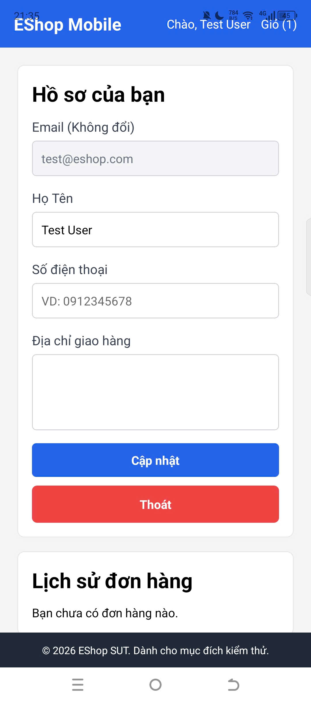
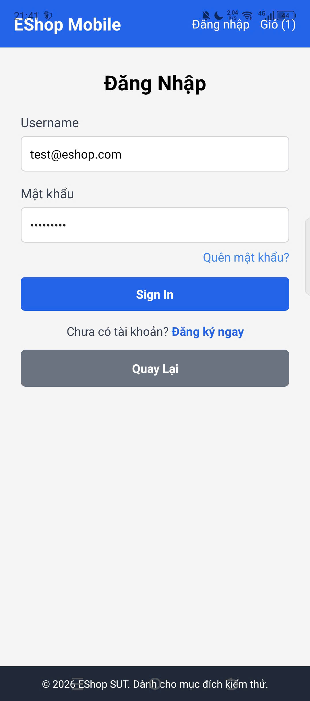
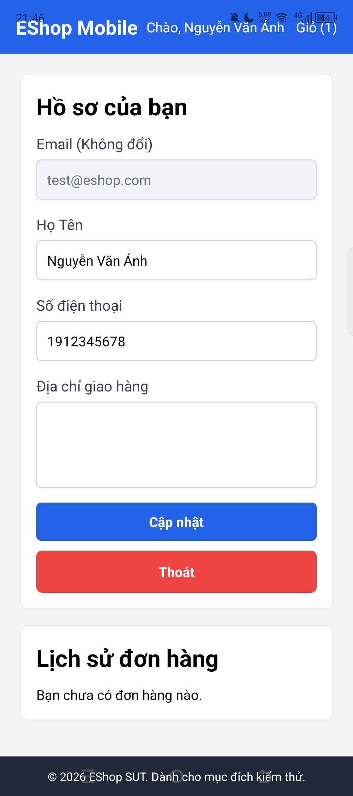
